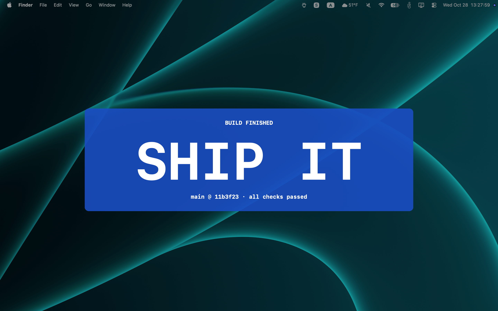

> **Out of date? See [Update](#update).**

# big-banner



Fullscreen attention banner for macOS. Plays a sound, dims the screen, shows your message in giant text. Click or press Escape to dismiss.

```
big-banner "STAND UP"
big-banner --no-sheet "DRINK WATER"   # floating banner only, no dim
big-banner --no-bell "meeting soon"   # no sound
big-banner --super "BUILD FAILED" --sub "main @ c85d485" "DEPLOY BLOCKED"   # optional smaller lines above/below
big-banner --danger "PROD IS DOWN"   # themes: --primary (default), --secondary, --tertiary, --danger, --monochrome
big-banner --pause "heads up"         # pause media while the banner is up
big-banner --hash                     # git commit this build came from (* suffix if built dirty)
make update                           # install the latest origin/main if yours is out of date
```

## Update

Pull first, then run the update:

```
git pull
make update          # install the latest origin/main if yours is out of date
make update-force    # same, but skip the confirmation prompt
```

## Install

Make sure ~/bin is on your path

```
make hard-install   # copies binary to ~/bin
# OR
make soft-install   # sym-links binary from build dir
```

### Download a prebuilt binary

Every push to `main` publishes a fresh binary to the `latest` release. Since the repo is public, no auth is needed:

```
mkdir -p ~/bin
curl -L https://github.com/chrisbenti/big-banner/releases/latest/download/big-banner -o ~/bin/big-banner

chmod +x ~/bin/big-banner
xattr -d com.apple.quarantine ~/bin/big-banner   # unquarantine, since it's unsigned
```

Or from the GitHub UI:

1. Go to the [latest release](https://github.com/chrisbenti/big-banner/releases/latest).
2. Under **Assets**, click `big-banner` to download it.
3. Move it into `~/bin` and make it executable:
   ```
   mkdir -p ~/bin
   mv ~/Downloads/big-banner ~/bin/big-banner
   chmod +x ~/bin/big-banner
   ```
4. Remove the quarantine flag, since the binary is unsigned (otherwise Gatekeeper will refuse to run it):
   ```
   xattr -d com.apple.quarantine ~/bin/big-banner
   ```

Make sure `~/bin` is on your `PATH` (e.g. `export PATH="$HOME/bin:$PATH"` in your `.zshrc`/`.bashrc`), then run it as `big-banner`.

## Server mode

Run big-banner as a tiny local HTTP server and trigger banners from anywhere: scripts, `curl`, or a bookmarklet on any website.

```
big-banner --serve                  # listens on 127.0.0.1:10000
big-banner --serve --port 4242      # pick a port
big-banner --serve --no-bell --danger   # other flags become defaults for every banner
```

On startup it prints the URL plus ready-to-paste JavaScript snippets for the port you chose.

Send `GET /?...` or `POST /` (JSON or form-encoded body) with these parameters:

| Parameter     | Meaning                                                              |
| ------------- | -------------------------------------------------------------------- |
| `text`/`msg`  | Main message (required)                                              |
| `super`/`sub` | Smaller lines above/below the message                                |
| `theme`       | `primary`, `secondary`, `tertiary`, `danger` or `monochrome`         |
| `bell=0`      | No alarm sound                                                       |
| `sheet=0`     | Floating banner instead of the full-screen overlay                   |
| `pause=1`     | Pause media while the banner is shown                                |

```
curl "http://127.0.0.1:10000/?text=BUILD%20DONE&theme=tertiary"
curl -X POST -H 'Content-Type: application/json' -d '{"text":"DEPLOYED","sub":"prod"}' http://127.0.0.1:10000/
```

Replies `202 {"queued": n}` straight away (`n` is the banner's place in line, 1 = showing now). Banners are queued: the next one appears after you dismiss the current one. Bad input gets a `400` with an `error` message.

### From JavaScript

```js
// Async, blocking: waits until the server has accepted the banner
const res = await fetch("http://127.0.0.1:10000/?" + new URLSearchParams({ text: "Hello", super: "Heads up", sub: "from JS" }));
console.log(await res.json());

// Async, non-blocking: fires the request and carries on immediately
fetch("http://127.0.0.1:10000/?" + new URLSearchParams({ text: "Hello" })).catch(() => {});
```

### Bookmarklet

CORS is wide open (`Access-Control-Allow-Origin: *`), so a bookmarklet works on any page. Save this as a bookmark URL:

```
javascript:fetch('http://127.0.0.1:10000/?text='+encodeURIComponent(document.title)+'&sub='+encodeURIComponent(location.host)).catch(()=>alert('big-banner is not running'))
```

Notes:

- The server only binds to `127.0.0.1`, so other machines on your network can't reach it. Any website you visit *can* (that's the point), so don't run it on a machine where that bothers you.
- Chrome may ask once per site for permission to access local network devices. Safari can block `http://127.0.0.1` requests from HTTPS pages.

## Claude Code integration

Claude Code [hooks](https://docs.claude.com/en/docs/claude-code/hooks) can fire a banner whenever Claude needs you (`Notification`) or finishes (`Stop`). The `--super`/`--sub` headers and themes make it easy to tell, at a glance, *which* session is talking and *what kind* of event it is:

- **Colors** distinguish the event. For example, `--secondary` for "needs your input" and `--primary` for "done" (or `--danger` for anything you really can't miss).
- **`--super`** carries the notification title.
- **`--sub`** carries the working directory, so you know which project is asking when you have several sessions open.
- **The main text** carries the message itself.

Hooks receive a JSON payload on stdin, so `jq` pulls out the pieces. Add these to `~/.claude/settings.json`:

```json
{
  "hooks": {
    "Notification": [
      {
        "hooks": [
          {
            "type": "command",
            "command": "in=$(cat); msg=$(jq -r '.message // \"Claude needs your input\"' <<<\"$in\"); title=$(jq -r '.title // empty' <<<\"$in\"); cwd=$(jq -r --arg h \"$HOME\" '.cwd // empty | if startswith($h) then \"~\" + .[($h|length):] else . end' <<<\"$in\"); big-banner --secondary --super \"$title\" --sub \"$cwd\" \"$msg\""
          }
        ]
      }
    ],
    "Stop": [
      {
        "hooks": [
          {
            "type": "command",
            "command": "in=$(cat); title=$(jq -r '.title // empty' <<<\"$in\"); cwd=$(jq -r --arg h \"$HOME\" '.cwd // empty | if startswith($h) then \"~\" + .[($h|length):] else . end' <<<\"$in\"); big-banner --primary --super \"$title\" --sub \"$cwd\" \"Claude is done\""
          }
        ]
      }
    ]
  }
}
```

What the shell is doing:

- `in=$(cat)` reads the hook payload once so it can be queried several times.
- `.message` and `.title` come straight from the notification; the message falls back to a default if it's missing.
- The `cwd` filter swaps your home directory for `~` so the sub header stays short.

If you'd rather keep it minimal, the simplest version is just a message and a color:

```json
{ "type": "command", "command": "big-banner --secondary \"Claude needs your input\"" }
```

Swap in `--danger`, `--tertiary`, or `--monochrome` to give other events (e.g. a `PostToolUse` hook on a failing command) their own look.

---

## How media pausing works

With `--pause`, big-banner pauses whatever is playing when it opens, then resumes it when you dismiss.

### The detection problem

The obvious API — MediaRemote's `MRMediaRemoteGetNowPlayingInfo` / `…IsPlaying` — has been blocked for unsigned apps since macOS 15.4. This is an **entitlement restriction**, not a code-signing issue. The `com.apple.mediaremote.*` entitlements are provisioned by Apple and cannot be self-assigned. A Developer ID cert doesn't help.

### The solution: CoreAudio `DeviceIsRunningSomewhere`

Instead, we ask CoreAudio: "is any process actively sending audio to the default output device?" This is a public API with no entitlements, no TCC permission prompt, and no signing required:

```swift
kAudioDevicePropertyDeviceIsRunningSomewhere  // UInt32: 0 = silent, 1 = audio flowing
```

It answers the only question we actually need: **is something playing?** (Not what, not which app — just whether.)

One caveat: a muted video reads as not-playing. For this use case that's fine.

### The control: MediaRemote send-command

CoreAudio can detect audio but can't control the source app. To actually pause/resume, we use `MRMediaRemoteSendCommand` with `kMRPause`/`kMRPlay`. The send path was not restricted along with the read path and works universally — Music, Spotify, browser video, podcasts, anything.

We load it via `dlopen`/`dlsym` rather than linking directly to avoid a hard dependency on a private framework.

### The gate: `didPause`

```
open:    isAudioPlaying()? → send pause → set didPause = true
close:   didPause? → send play → reset didPause
```

Resume is strictly gated on `didPause`. If nothing was playing when the banner opened, closing it does nothing. No toggle desync, no starting something that wasn't already running.

## Update badge

When your installed build is behind `origin/main`, the banner shows an "Update Available" badge in its top-right corner. Clicking the badge opens the [Update](#update) instructions in your browser.

- **How it checks:** at most once every 24 hours, `big-banner` asks the GitHub API (`https://api.github.com/repos/chrisbenti/big-banner/commits/main`) for the latest commit sha and compares it to the commit your binary was built from (`big-banner --hash`). If they differ, the badge shows.
- **Never blocks the banner:** the banner appears immediately using the last cached answer. If the cache is stale, the fetch runs in the background and the badge appears when it finishes. The attempt is recorded before the fetch starts, so dismissing the banner early or launching several at once doesn't trigger repeat requests. A failed fetch (offline, rate limited) keeps the previous answer and is retried after another 24 hours.
- **Dirty builds are skipped:** if your build was made from a tree with uncommitted changes (`--hash` ends in `*`), nothing is fetched and the badge never shows.
- **Cache file:** `~/Library/Caches/big-banner/update-check.json`, holding the latest known sha and when it was checked, e.g. `{"checkedAt":"2026-10-28T20:19:59Z","sha":"5e4a782..."}`. Delete it to force a fresh check on the next banner. Nothing else is stored, and the only network request is the one above.
- **Testing:** set `BIG_BANNER_FORCE_UPDATE_CHECK=1` to ignore the dirty-build skip and the 24-hour cache.
